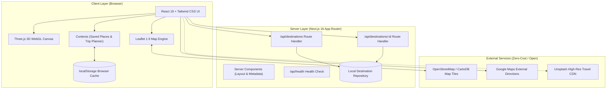

# TerraVista — Tech Stack & Feature Architecture Specification

> **Project Name:** TerraVista — Smart Tourism & Travel Explorer  
> **Repository:** `terravista`  
> **Document Version:** 1.0.0  
> **Target Audience:** College Evaluators, Project Reviewers, and Developers  

---

## 1. Core Technology Stack Overview

| Category | Technology / Library | Version | Role in Architecture |
| :--- | :--- | :--- | :--- |
| **Framework** | [Next.js](https://nextjs.org/) (App Router) | `16.4.0` | Full-stack React framework providing SSR, Turbopack, and API Route Handlers |
| **UI Library** | [React](https://react.dev/) / React DOM | `19.3.0` | Declarative component UI engine with React 19 Client & Server components |
| **Language** | [TypeScript](https://www.typescriptlang.org/) | `^5.0.0` | End-to-end static typing, interface contracts, and compilation safety |
| **Styling** | [Tailwind CSS](https://tailwindcss.com/) | `^4.0.0` | Utility-first CSS engine with `@tailwindcss/turbopack` integration |
| **3D Graphics** | [Three.js](https://threejs.org/) | `^0.186.1` | WebGL-based procedural 3D terrain, mountain ridges, water surfaces, and lighting |
| **3D Typings** | `@types/three` | `^0.186.0` | Comprehensive TypeScript declarations for Three.js geometries and shaders |
| **Geospatial / Maps** | [Leaflet](https://leafletjs.com/) | `^1.9.4` | Open-source mobile-friendly interactive mapping engine |
| **Map Typings** | `@types/leaflet` | `^1.9.22` | Type definitions for Leaflet layers, markers, icons, and popups |
| **Iconography** | [Lucide React](https://lucide.dev/) | `^1.56.0` | Clean, accessible SVG icon library for travel, navigation, and UI indicators |
| **Map Tiles** | [OpenStreetMap](https://www.openstreetmap.org/) CartoDB | Public Tiles | Tile server providing raster cartography without paid API keys |
| **Linting & Code Quality** | ESLint + `eslint-config-next` | `^9.0.0` | Strict code analysis and Next.js best practice enforcement |

---

## 2. Feature-by-Feature Tech Breakdown

### 2.1. Feature 1: Cinematic 3D Terrain & Atmospheric Hero
* **Components:**
  * `src/components/3d/CinematicTerrainCanvas.tsx`
  * `src/components/features/Hero3DPreviewStage.tsx`
  * `src/components/features/AtmosphericBackdrop.tsx`
* **Technologies Used:**
  * **Three.js (`three`)**: Generates procedural parametric mountain ridges using `PlaneGeometry` with sinusoidal vertex displacement, simulated water body with wave frequencies, ambient lights, directional sunset sunlight, and exponential fog (`FogExp2`).
  * **WebGL Canvas API**: Responsive rendering loop (`requestAnimationFrame`) with automatic device pixel ratio scaling (`Math.min(window.devicePixelRatio, 2)`).
  * **Graceful Degradation / Fallback**: Automatic GPU error handling that renders a layered CSS gradient backdrop if WebGL is unavailable or disabled.
  * **Tailwind CSS Glassmorphism**: Frosted glass HUD overlays (`backdrop-blur-md`, `bg-slate-950/60`, `border-white/10`).

---

### 2.2. Feature 2: Interactive Geographic Map Explorer
* **Components:**
  * `src/components/map/LeafletMap.tsx`
  * `src/components/map/DynamicLeafletMap.tsx`
  * `src/components/features/InteractiveMapSection.tsx`
* **Technologies Used:**
  * **Leaflet 1.9 (`leaflet`)**: Direct map lifecycle management, viewport bounds clamping, smooth pan-and-zoom animations (`flyTo`), and custom HTML pin markers (`divIcon`).
  * **Next.js Dynamic Imports (`next/dynamic`)**: Server-Side Rendering (SSR) bypass with `ssr: false` to ensure Leaflet only initializes in browser environments where `window` and `document` exist.
  * **OpenStreetMap & CartoDB Tile Server**: Free, open-access tile layer (`https://{s}.basemaps.cartocdn.com/rastertiles/voyager/{z}/{x}/{y}{r}.png`) with standard OSM attribution.
  * **Bidirectional Map-List Sync**: Selecting a marker focuses the card list, and clicking a card triggers `map.flyTo([lat, lng], 14)`.

---

### 2.3. Feature 3: Real-Time Search & Category Filtering
* **Components:**
  * `src/components/features/ExploreFilterBar.tsx`
  * `src/components/features/ExpeditionExplorer.tsx`
* **Technologies Used:**
  * **React 19 Hooks (`useState`, `useMemo`)**: High-performance in-memory filtering that computes subset matching across destination names, locations, categories, and tags with zero lag.
  * **TypeScript Typed Categories**: Type-safe filtering constrained to `'All' | 'Beaches' | 'Heritage' | 'Religious Places' | 'Nature' | 'Viewpoints'`.
  * **Lucide React Icons**: Distinct vector icons per category pill (`Compass`, `Palmtree`, `Landmark`, `Flame`, `Trees`, `Eye`).

---

### 2.4. Feature 4: Destination Detail Inspection Modal
* **Components:**
  * `src/components/features/ExpeditionDetailModal.tsx`
  * `src/components/features/ExpeditionCard.tsx`
* **Technologies Used:**
  * **React Portal Architecture**: Modals rendered with accessible click-outside dismissal and keyboard `Esc` listener.
  * **External Directions Protocol**: Dynamic URI generation targeting Google Maps navigation (`https://www.google.com/maps/dir/?api=1&destination=${lat},${lng}`).
  * **Dynamic Image Fallbacks**: Graceful fallback handlers for remote photographic previews.

---

### 2.5. Feature 5: Bookmarking & Favourites System
* **Components:**
  * `src/context/SavedPlacesContext.tsx`
  * `src/components/features/SavedPlacesModal.tsx`
* **Technologies Used:**
  * **React Context API (`createContext`, `useContext`)**: Global state distribution for bookmarked destination IDs without prop drilling.
  * **Browser Web Storage (`localStorage`)**: Client-side JSON persistence (`terravista_saved_places`) surviving page reloads.
  * **Reactivity**: Instant badge counter updates in the top navigation bar when destinations are added or removed.

---

### 2.6. Feature 6: Dynamic Trip Itinerary Planner
* **Components:**
  * `src/context/TripPlannerContext.tsx`
  * `src/components/features/TripItineraryModal.tsx`
* **Technologies Used:**
  * **React Context API (`TripPlannerContext`)**: Manages ordered itinerary stops (`TripStop[]`).
  * **Sequence Reordering Logic**: Move-up, move-down, and remove actions for multi-stop route construction.
  * **Haversine Distance Formulation**: Mathematical calculation of travel distance (km) between sequential GPS coordinates.
  * **Multi-destination Google Maps Export**: Constructs multi-waypoint navigation URLs for real-world travel execution.

---

### 2.7. Feature 7: REST API Route Handlers (Backend)
* **Endpoints:**
  * `src/app/api/destinations/route.ts`: List all destinations with optional `?category=` and `?search=` query parameter filtering.
  * `src/app/api/destinations/[id]/route.ts`: Retrieve a specific destination by its slug/ID with `404 Not Found` handling.
  * `src/app/api/health/route.ts`: System health check returning server uptime, environment status, and timestamp.
* **Technologies Used:**
  * **Next.js App Router Route Handlers (`NextResponse`)**: Native web standard `Request` and `Response` objects.
  * **Decoupled Architecture**: Prepared for optional database backends (e.g., Supabase / PostgreSQL) without breaking local mock operations.

---

### 2.8. Feature 8: UI Design System & Component Library
* **Components:**
  * `src/components/ui/Button.tsx`: Accessible variant-driven buttons (`primary`, `secondary`, `glass`, `ghost`, `danger`).
  * `src/components/ui/Badge.tsx`: Pill badges with semantic category coloring.
  * `src/components/ui/Card.tsx`: Reusable cards with hover glow and glass borders.
  * `src/components/ui/Input.tsx`: Form inputs with integrated icon slots and focus transitions.
  * `src/components/layout/Navbar.tsx`: Responsive navigation with mobile menu drawer and live indicators.
  * `src/components/layout/Footer.tsx`: Comprehensive platform information and technical credits.

---

## 3. High-Level Architecture Diagram

---

## 4. Key Engineering Highlights for College Evaluation

1. **Zero External Paid Dependencies**: Works 100% out-of-the-box without requiring credit card registration, third-party tokens, or paid cloud APIs.
2. **Modern Next.js 16 + React 19 Architecture**: Utilizes Turbopack compilation and the Next.js App Router standard.
3. **SSR-Safe Dynamic Execution**: Implements clean client boundaries for browser-exclusive APIs (WebGL, Leaflet, `localStorage`).
4. **Performance & Lightweight Footprint**: Pure CSS backdrop filters and mathematically optimized Three.js meshes maintain 60 FPS performance.
5. **Full TypeScript Coverage**: 100% strictly typed codebase with comprehensive interfaces for destinations, itineraries, and map states.
